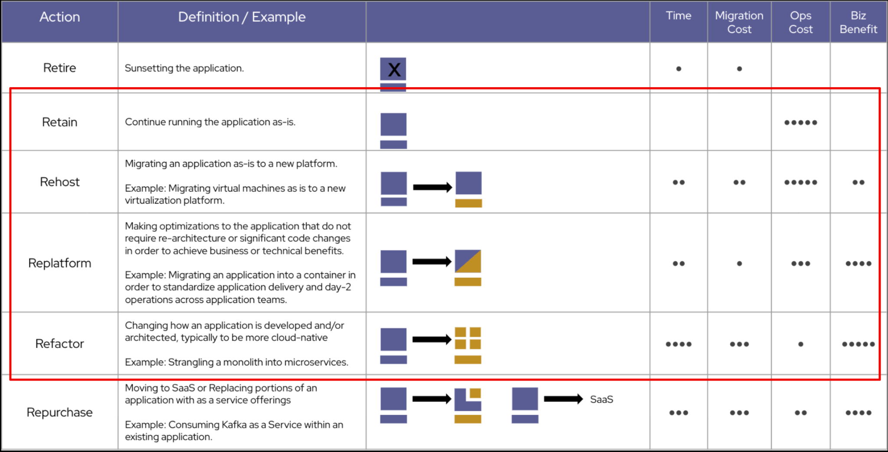
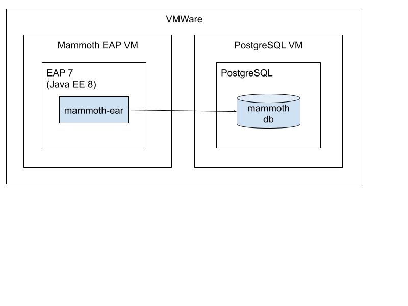
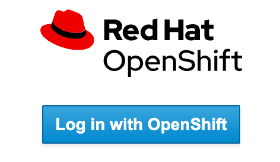

# Module 1: Introduction to the Mammoth Application

As a developer participating in this lab, your main goal is the modernization of **Mammoth**, a legacy monolithic application.

There are different strategies we will be using to modernize this application.



The main focus for this lab is going to be around the **Retain**, **Rehost**, **Replatform** and **Refactor** strategies.

But before we jump into our modernization journey, let's take a closer look at the Mammoth application.

## Application Overview

Mammoth is currently built on **Java EE 8** and runs on a **JBoss EAP 7** server inside a VM. It includes a backend component that provides APIs for serving facts about mammoths, along with a frontend component that provides a user interface to display those facts.

The backend component retrieves facts about mammoths from the **Mammoth DB**. This is a PostgreSQL database that is deployed in another VM.



> **TASK:** You can access the source code for this application [here](https://github.com/shirodkar/mammoth-ear).

## Exploring the Application in Dev Spaces

The IDE you will be using today is **OpenShift Dev Spaces**. This is a browser-based IDE that is preconfigured with everything you need as a developer to implement, test and commit the code to Git.

To explore the application in OpenShift Dev Spaces, follow these steps:

> **TASK:** Click on the contributor badge [](https://devspaces.apps.${OCP_BASE_URL}/#https://github.com/shirodkar/mammoth-ear) in the README section, or click on [this link](https://devspaces.apps.${OCP_BASE_URL}/#https://github.com/shirodkar/mammoth-ear).

> **TASK:** If prompted, click on the **"Login with OpenShift"** button.



> **TASK:** Provide your OpenShift credentials:
> - **Username:** `${USERNAME}`
> - **Password:** `${PASSWORD}`

> **Note:** It may take a few minutes for the workspace to be set up. A new namespace and a workspace pod is being created which encapsulates all the containers that are required.

## Dev Spaces Workspace Containers

There are 3 main containers running in the Dev Spaces workspace:

| Container      | Purpose                                                                                           |
| -------------- | ------------------------------------------------------------------------------------------------- |
| **tools**      | The main container where all of the tooling is available to implement the code.                   |
| **eap**        | Container where the EAP 7 server will run to test the application.                                |
| **postgresql** | Container where an instance of PostgreSQL database runs. The EAP server connects to this database to retrieve facts about mammoths. |

## Running the Application

If you click on the search bar on top, then select **Run task** and then **devfile**, you will see various commands that you can use:

| Task                     | Description                                                                                      |
| ------------------------ | ------------------------------------------------------------------------------------------------ |
| **Start EAP**            | Provisions and starts the EAP 7 server in the eap container, and configures it to connect to the database. |
| **Test application**     | Execute the unit and integration tests.                                                          |
| **Build application**    | Runs the Maven build to package the application as an EAR.                                       |
| **Deploy application**   | Deploys the application EAR to the EAP server.                                                   |

### Start EAP

> **TASK:** Execute the **"Start EAP"** task. You should see the following output:

```
EAP 7 configured
EAP 7 is running
EAP 7 initialized with PostgreSQL datasource
 *  Terminal will be reused by tasks, press any key to close it.
```

### Build the Application

> **TASK:** Execute the **"Build application"** task. You should see the following output:

```
[INFO] ------------------------------------------------------------------------
[INFO] Reactor Summary for Mammoth EAR 1.0.0-SNAPSHOT:
[INFO] 
[INFO] Mammoth EAR ........................................ SUCCESS [  1.466 s]
[INFO] Mammoth Backend API ................................ SUCCESS [  6.523 s]
[INFO] Mammoth Frontend ................................... SUCCESS [  0.377 s]
[INFO] Mammoth EAR Package ................................ SUCCESS [  0.826 s]
[INFO] ------------------------------------------------------------------------
[INFO] BUILD SUCCESS
[INFO] ------------------------------------------------------------------------
[INFO] Total time:  9.365 s
[INFO] Finished at: 2026-07-29T00:56:57Z
[INFO] ------------------------------------------------------------------------
 *  Terminal will be reused by tasks, press any key to close it.
```

### Deploy the Application

> **TASK:** Execute the **"Deploy application"** task. You should see the following output:

```
 *  Executing task: devfile: Deploy application 

 *  Terminal will be reused by tasks, press any key to close it.
```

### Access the Application

> **TASK:** Access the application in a new browser tab using the URL:
> `http://admin-mammoth-ear-eap-http.apps.${OCP_BASE_URL}/index.xhtml`

---

**Next:** [Module 2: Upgrading to EAP 8](module2.md)
