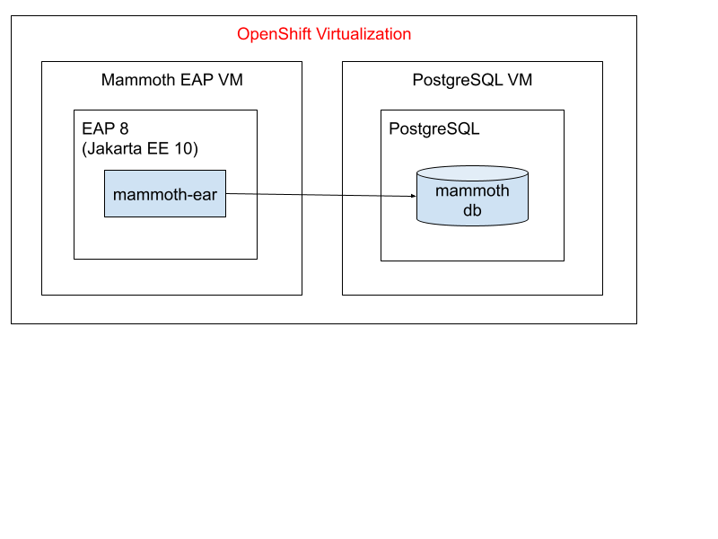
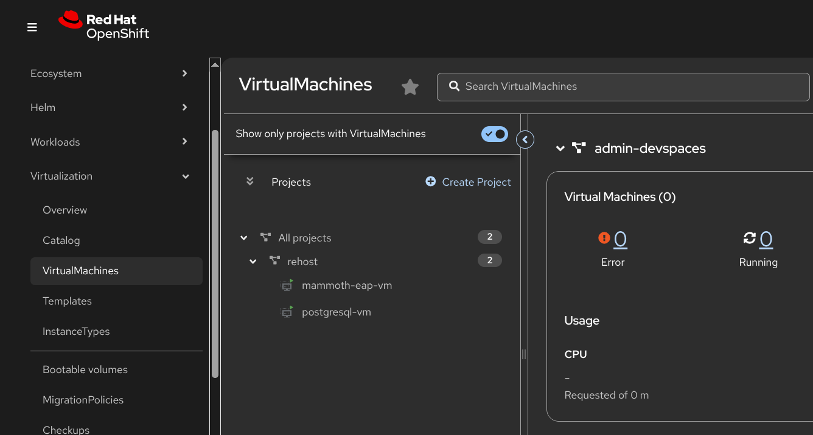

# Module 3: Rehosting to OpenShift Virtualization

The Mammoth application and its Database have already been rehosted on **OpenShift Virtualization**.

## Accessing the Rehosted Application

> **TASK:** Log into the OpenShift console as a developer user.

> **TASK:** Using the dropdown in the top left corner, switch to the **Virtualization** perspective.

> **TASK:** Select **'Virtual Machines'**.

> **TASK:** Expand the **'rehost'** project. You should be able to see both VMs listed — `mammoth-eap-vm` and `postgresql-vm`.

> **TASK:** Select **Networking → Routes** and click on the Route URL. It will launch the rehosted Mammoth application in a new browser tab. (Make sure that the URL starts with `http://`)

## Migration Toolkit for Virtualization (MTV) Demo

For a demo of how to migrate VMs using the Migration Toolkit for Virtualization (MTV), please see the following videos:

- [MTV Demo - Video 1](https://youtu.be/Heboif_e7WE?si=aXhN2szr12yeiPJw)
- [MTV Demo - Video 2](https://www.youtube.com/watch?v=fQKoUm3MMoE)

---

**Next:** [Module 4: Replatforming to OpenShift Containers](module4.md)
