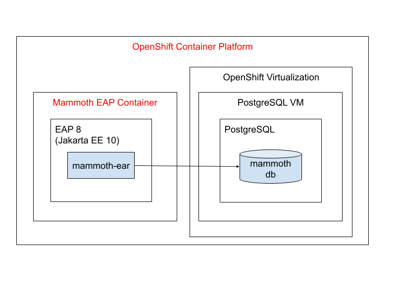
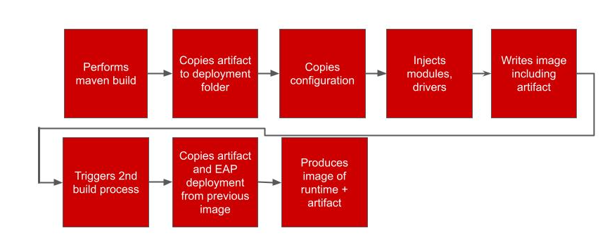

# Module 4: Replatforming to OpenShift Containers

In this module, we will run the upgraded Jakarta EE 10 application on a **"containerized" JBoss EAP 8** server. The container itself will be managed by the **JBoss EAP 8 Operator** on OpenShift.



## Source Code Changes

We need to create a container image of the application and the EAP runtimes.

To do this, we first need to modify the application build process a bit.

> **TASK:** In Dev Spaces, create a new branch called **'replatform'**.

### Add to Parent POM (`/pom.xml`)

> **TASK:** Add the following to the parent `pom.xml`:

```xml
<repositories>
    <repository>
        <id>jboss</id>
        <url>https://maven.repository.redhat.com/ga/</url>
        <snapshots>
            <enabled>false</enabled>
        </snapshots>
    </repository>
</repositories>

<pluginRepositories>
    <pluginRepository>
        <id>jboss</id>
        <url>https://maven.repository.redhat.com/ga/</url>
        <snapshots>
            <enabled>false</enabled>
        </snapshots>
    </pluginRepository>
</pluginRepositories>
```

### Add to EAR POM (`/ear/pom.xml`)

> **TASK:** Add the following to the EAR `pom.xml`:

```xml
<profiles>
    <profile>
        <id>openshift</id>
        <build>
        <plugins>
            <plugin>
                <groupId>org.jboss.eap.plugins</groupId>
                <artifactId>eap-maven-plugin</artifactId>
                <version>2.0.0.Final-redhat-00009</version>
                <configuration>
                    <channels>
                        <channel>
                            <manifest>
                                <groupId>org.jboss.eap.channels</groupId>
                                <artifactId>eap-8.1</artifactId>
                            </manifest>
                        </channel>
                    </channels>
                    <feature-packs>
                        <feature-pack>
                            <location>org.jboss.eap:wildfly-ee-galleon-pack</location>
                        </feature-pack>
                        <feature-pack>
                            <location>org.jboss.eap.cloud:eap-cloud-galleon-pack</location>
                        </feature-pack>
                        <feature-pack>
                            <location>org.jboss.eap:eap-datasources-galleon-pack</location>
                        </feature-pack>
                    </feature-packs>
                    <layers>
                        <layer>cloud-server</layer>
                        <layer>ejb</layer>
                        <layer>jsf</layer>
                        <layer>postgresql-datasource</layer>
                    </layers>
                    <galleon-options>
                        <jboss-fork-embedded>true</jboss-fork-embedded>
                    </galleon-options>
                </configuration>
                <executions>
                    <execution>
                        <goals>
                            <goal>package</goal>
                        </goals>
                    </execution>
                </executions>
            </plugin>
        </plugins>
    </build>
    </profile>
</profiles>
```

> **Note:** Changes were made only to the Maven build, i.e. `pom.xml` files.

You can also execute `jboss-cli` scripts easily just by modifying the `eap-maven-plugin` configuration above.

In addition, if there are custom modules that you would like to add to the EAP server, that can also be done easily using the `eap-maven-plugin` configuration.

## Build

Now that the application build is modified, we will now work on building the container image. This involves a 2-step process:



### Source-to-Image (S2I)

> **TASK:** Execute the `mammoth-eap8-build-artifacts` build in the **cicd** project.

### EAP Runtime Image

The `mammoth-eap8` build will automatically execute once the previous build completes.

## Deploy

### Database

We will continue to use the same PostgreSQL database VM that was rehosted in the previous module under the **rehosted** project.

### Mammoth-ear Application

The **JBoss EAP Operator** has already been installed on the OpenShift cluster.

An instance of **WildflyServer** has also been created which deploys the image created above.

The application can be accessed using the URL provided by the `mammoth-route` OpenShift Route under the **replatform** project.
